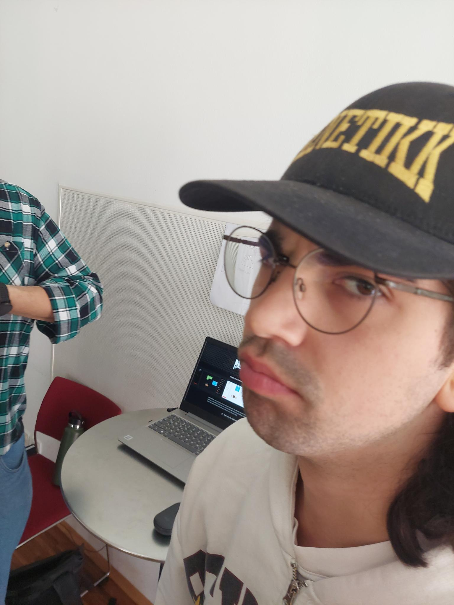
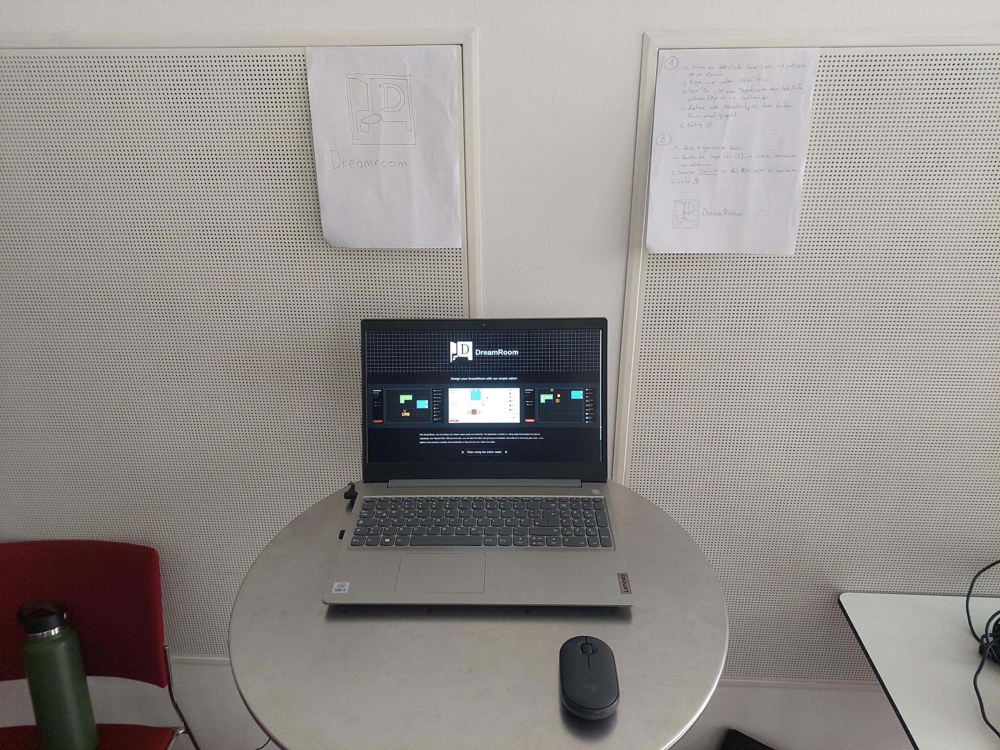
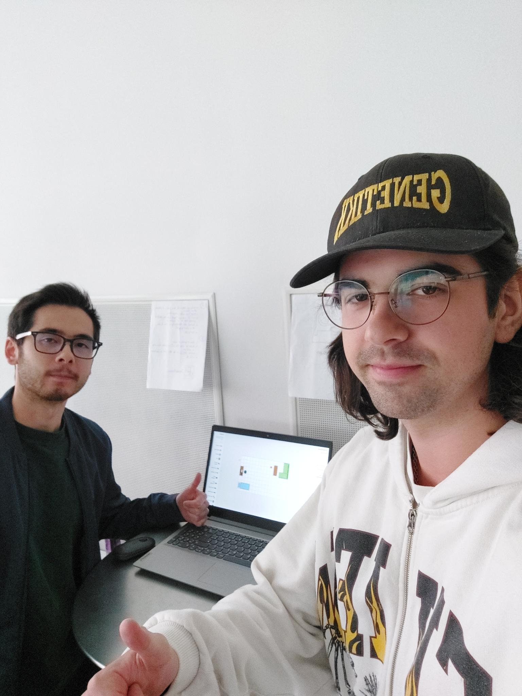
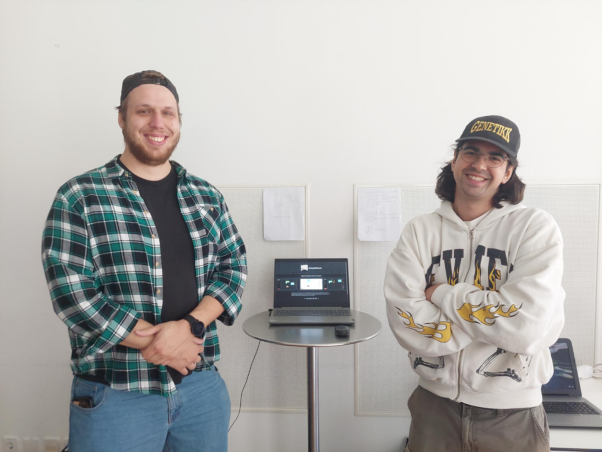

# Feedback aus dem User Testing

### Das User Testing

- Das User Testing fand statt am Freitag, den 16. Mai 2025, in der FH Salzburg.
- Unser Setup bestand aus einem Laptop, einer Maus, und zwei Blättern (Siehe __User Testing Bilder__).
    - Auf den Blättern standen Anweisungen für die Tester, es waren zwei Aufgaben
    - Die Tester konnten sich entscheiden, ob sie keine der Aufgaben machen und einfach DreamRoom ausprobieren, oder ob sie einer oder beide der Aufgaben lösen wollen
    - Wir sammelten User Feedback von ungf. 8 verschiedenen Leuten
        - Nicht jeder hat Feedback gegeben, DreamRoom kam größtenteils positiv an
    - Wir blieben 2 Stunden am User Feedback Tag, sammelten jedoch auch ausserhalb des User Testings noch Feedback von Kommilitonen und Bekannten
    - Das Feedback haben wir in einem Notizbuch mitgeschrieben, auf Per-User-Basis

### Bugs

- Blaues Object Highlight geht manchmal verloren
    - Konnten den Bug nicht reproduzieren, könnte Driver Bug gewesen sein
- Texteingabe & Hotkey Konflikt
    - Gefixt

### Features

- Text zu klein in der Layer View
    - Hinzugefügt, einheitlicher gemacht
- Harald will einen Ventilator
    - Hinzugefügt, hinzugefügt als "Standing Fan"
- Default Layer Positions (z.B. Teppich immer unten)
    - Hinzugefügt
- Mehr Keybinds -> . , backspace (rotieren und entfernen)
    - Hinzugefügt
- Raumgröße bei Room Select in Metern, nicht Centimetern
    - Hinzugefügt
- Deutsche Aliase für Objekte
    - Die App ist ausgelegt auf die englische Sprache, nicht wichtig
- Keybind View ist unübersichtlich
    - Hinzugefügt
- Hover Effect / Homebutton
    - Hinzugefügt, btn Klasse hinzugefügt

### Positives Feedback

- "Super" ~ Elias

### User Testing Bilder

